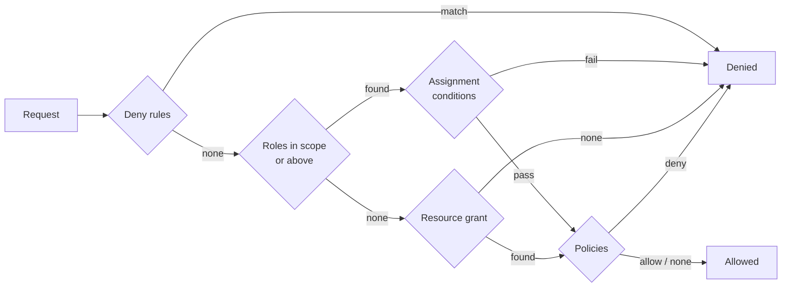

<div align="center">


# access-control-hub

The admin console for [spring-iam](https://github.com/mesubash/spring-iam).<br />
Manage users, roles, scopes and policies, read the audit log, and see exactly why a request was allowed or denied.

[](https://access-control-console.vercel.app)
[](https://github.com/mesubash/access-control-hub/actions/workflows/ci.yml)
[](LICENSE)
[](https://github.com/mesubash/spring-iam)


</div>

> [!TIP]
> **Try it in ten seconds:** open the [live demo](https://access-control-console.vercel.app). There's no backend and any password works.
> Sign in as `admin@example.com` for full access, or `auditor@example.com` to see the read-only view.

## The spring-iam family

| Repo                                                           | For                                                     |
| -------------------------------------------------------------- | ------------------------------------------------------- |
| [spring-iam](https://github.com/mesubash/spring-iam)           | The IAM service: tokens, roles, scopes, policies, audit |
| [accounts-portal](https://github.com/mesubash/accounts-portal) | Sign-in pages your users see                            |
| **access-control-hub**                                         | This console, for the people who run it                 |

## What you can do

| Page                   | What it's for                                                                             |
| ---------------------- | ----------------------------------------------------------------------------------------- |
| **Overview**           | Counts of scopes, roles, assignments and policies, and the latest changes                 |
| **Users**              | Search everyone; suspend, unlock, reset a password or two-step verification; add a user   |
| **Scopes**             | Your organisation as a tree (company, country, branch). Access given higher up flows down |
| **Roles**              | Bundles of permissions you hand out together                                              |
| **Permissions**        | The catalogue of `domain.resource.action` keys                                            |
| **Assignments**        | Who has which role, and in which scope                                                    |
| **Groups**             | Give a role to a group once instead of to each person                                     |
| **Deny rules**         | Block one permission for one user, whatever their roles say                               |
| **Policies**           | Rules on attributes like time or amount, with a shadow mode to try them safely            |
| **Resource grants**    | One permission on one specific record                                                     |
| **Services**           | Backends that call the IAM with an API key                                                |
| **Audit log**          | Admin actions, sign-in and account events, and every decision for a user                  |
| **Explain a decision** | Ask "can this user do this here?" and watch each step of spring-iam's decision            |

The sidebar only shows what the signed-in admin's permissions allow, and pages hide actions they can't take.

## How a decision is made

**Explain a decision** shows spring-iam's pipeline step by step. A deny anywhere stops it.



## Quick start

<details open>
<summary><b>Demo mode</b>: no backend needed</summary>

<br />

```sh
bun install
VITE_DEMO=true bun run dev        # http://localhost:3000
```

Every request is answered in the browser by [`src/api/demo.ts`](src/api/demo.ts), with linked sample data:
an organisation tree, roles, eight users in different states, policies, a deny rule and an audit trail.
Changes you make are logged to the audit trail like the real thing.

| Email                 | Access                                   |
| --------------------- | ---------------------------------------- |
| `admin@example.com`   | Everything                               |
| `auditor@example.com` | Read-only: every change comes back `403` |

</details>

<details>
<summary><b>With spring-iam</b></summary>

<br />

```sh
IAM_URL=http://localhost:8080 bun run dev
```

The app server proxies `/api/**` to `IAM_URL`, so spring-iam's refresh cookie stays on this origin.
Sign in with an account that holds an admin role such as `SuperAdmin`, `AccessAdmin` or `AuditViewer`.
If that role requires two-step verification, set it up first through [accounts-portal](https://github.com/mesubash/accounts-portal).

</details>

## Configuration

Copy `.env.example` to `.env`. All values are read at build time.

| Variable        | Default                 | Purpose                                           |
| --------------- | ----------------------- | ------------------------------------------------- |
| `VITE_APP_NAME` | `Access Control`        | Name in the sidebar and page titles               |
| `IAM_URL`       | `http://localhost:8080` | Where `/api/**` is proxied                        |
| `VITE_DEMO`     | (off)                   | `true` answers the API in the browser. Demos only |

To rebrand the colour, change `--brand` in [`src/styles.css`](src/styles.css).

## Deploy

```sh
IAM_URL=https://iam.internal:8080 bun run build
bun run start                     # node .output/server/index.mjs on port 3000
```

> [!WARNING]
> Never build with `VITE_DEMO=true` in front of a real IAM. Demo mode accepts any password.

## Security

- **Tokens in memory only.** The access token never touches `localStorage`; a reload restores the session from spring-iam's httpOnly refresh cookie.
- **Same-origin API.** Calls go through the app server's proxy, so the refresh cookie stays first-party.
- **One refresh at a time.** Parallel `401`s share a single refresh instead of racing the cookie rotation.
- **Server decides.** Hiding a button is a convenience; every action is still checked by spring-iam.

## Development

```sh
bun run lint && bun run typecheck && bun run test && bun run build
```

```
src/
├── routes/        one file per page
├── components/iam layout, tables, badges, user labels
├── context/       session and permissions
└── api/
    ├── client.ts  fetch, envelope, refresh
    ├── resources.ts  every spring-iam endpoint used
    ├── demo.ts    in-browser fake IAM for demo mode
    └── *.test.ts  Vitest
```

**Not included yet:** role hierarchy, permission groups, break-glass access and context attributes.
spring-iam supports them; the console doesn't show them yet.

## License

[MIT](LICENSE)
